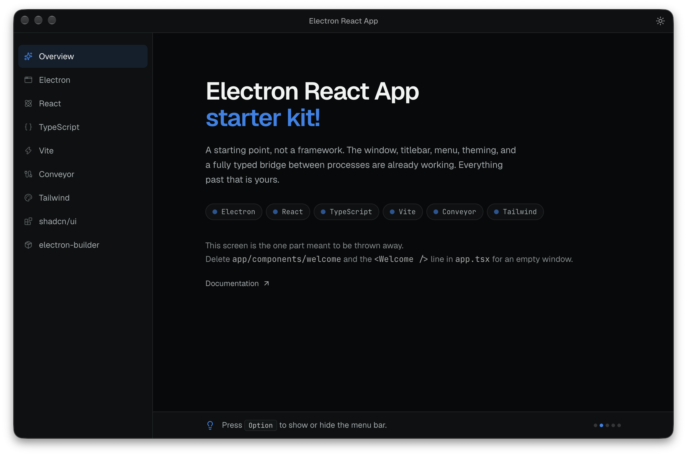

# Electron React App

A modern Electron starter kit with React, Vite and TypeScript, built around
electron-conveyor for type-safe IPC and a smoother dev experience.

<br />

<p align="center">
    
</p>

<br />

<div align="center">

 &nbsp;
 &nbsp;
 &nbsp;
 &nbsp;
 &nbsp;


</div>

<br />

## Features

- 🚀 **Electron** - Cross-platform desktop apps for Windows, macOS and Linux
- ⚛️ **React** - Component-based UI library
- 📦 **TypeScript** - Type-safe JavaScript across main, preload and renderer
- 🎨 **Shadcn UI** - Beautiful and accessible components on Radix
- 🌊 **TailwindCSS** - Utility-first CSS framework
- ⚡ **Electron Vite** - Lightning-fast build tool, powered by Vite
- 🛠️ **Electron Builder** - Packaging for Windows, macOS and Linux
- 🔌 **Electron Conveyor** - Type-safe IPC, queries, commands, streams and events via [electron-conveyor](https://github.com/guasam/electron-conveyor)
- 🔄 **Cross-window state** - Stores owned by main, synced live to every window, with opt-in persistence
- 🪟 **Custom window shell** - Themed frame, titlebar and menus with keyboard shortcuts
- 🌗 **Dark/Light mode** - Built-in theme switching
- 🔥 **Fast HMR** - Instant renderer updates, and main and preload restart on save
- 🛡️ **Error boundary** - Catches render errors with detailed reporting
- 📐 **Clean project structure** - Separation of main, preload and renderer processes
- 🧩 **Path aliases** - Keeps your code organized
- 📁 **Resources protocol** - Load local resources from the renderer via `res://`
- 🧹 **ESLint & Prettier** - Preconfigured for consistent code
- 🐞 **VS Code debugging** - Launch configs for both main and renderer
- 🧪 **Demo branch** - Interactive playground of every IPC primitive, while `main` stays minimal

<br />

## Quick start

```bash
git clone https://github.com/guasam/electron-react-app
cd electron-react-app

# any package manager works: npm, yarn, pnpm, bun
npm install
npm run dev
```

That starts Electron with hot reload. `main` is deliberately minimal (a themed window frame,
titlebar, menus and the typed IPC layer) so you can start building on top of it right away.

<br />

### Removing the welcome screen

The window opens on a short tour of the stack. It is the one piece meant to be thrown away, and it
is built so that removing it costs nothing: it lives entirely in `app/components/welcome`, nothing
else imports it, and it adds no IPC modules of its own.

```bash
rm -rf app/components/welcome
```

Then drop the `<Welcome />` line and its import from `app/app.tsx`. What is left is an empty window
with the shell still around it, ready for your app.

<br />

### Try the demo

Want to see everything the stack can do first? The **`demo`** branch is an interactive playground of
every IPC primitive (streaming, a folder scan, a system monitor, cross-window state, and middleware):

```bash
git switch demo
npm install
npm run dev
```

Switch back to `main` and re-run `npm install` when you are ready to build.

<br />

## Conveyor: Type-safe IPC

IPC is powered by [electron-conveyor](https://github.com/guasam/electron-conveyor). One definition
in main is the single source of truth for a feature, and the renderer client is _inferred_ from it.

| You want                          | Use             | Renderer side                                             |
| --------------------------------- | --------------- | --------------------------------------------------------- |
| Read something from main          | `query()`       | `await conveyor.x.y()` or `.useQuery()`                   |
| Tell main to do something         | `command()`     | `await conveyor.x.y()` or `.useMutation()`                |
| Chunks pushed as they're produced | `stream()`      | `for await (const c of conveyor.x.y())` or `.useStream()` |
| Main pushing to the renderer      | `event()`       | `conveyor.x.y.subscribe(cb)` or `.useEvent(cb)`           |
| State shared live across windows  | `defineStore()` | `useConveyorStore(store)`                                 |

<br />

### Adding a feature takes two edits

**1. Define the module** in `conveyor/modules/`:

```ts
// conveyor/modules/notes.ts — runs in MAIN only
import { z } from 'zod'
import { defineModule, query, command } from '../init'

export const notesModule = defineModule({
  list: query(() => readNotes()),

  // input crosses the trust boundary → schema required, validated on every call
  save: command(z.object({ title: z.string(), body: z.string() }), ({ input }) => saveNote(input)),
})
```

**2. Register it** in `conveyor/router.ts`:

```ts
export const router = createRouter(
  {
    window: windowModule,
    web: webModule,
    notes: notesModule, // ← the key becomes the module id
  },
  { createContext, use: [devLogger] }
)
```

That's it. The renderer client already knows it, fully typed:

```tsx
import { conveyor } from '@/conveyor/client'

function Notes() {
  const notes = conveyor.notes.list.useQuery() // key derived from the path — never hand-written
  const save = conveyor.notes.save.useMutation({
    onSuccess: () => conveyor.notes.list.invalidate(),
  })

  return <button onClick={() => save.mutate({ title: 'Hi', body: '...' })}>Save</button>
}
```

Outside React, every member is a plain typed call: `await conveyor.notes.list()`.

<br />

## Error boundary

Failures re-throw in the renderer as `ConveyorError` with a stable `code`. Conveyor reserves
`UNKNOWN_PROCEDURE`, `INVALID_INPUT`, `INVALID_OUTPUT` and `HANDLER_ERROR`; anything your handler
throws deliberately keeps its own code:

```ts
// main
throw new ConveyorError('LOCKED', 'Unlock the vault first')

// renderer
try {
  await conveyor.vault.open()
} catch (err) {
  if (err instanceof ConveyorError && err.code === 'LOCKED') promptUnlock()
}
```

Branch on `err.code`, never on message strings. Validation failures also carry `err.issues` with
the Standard Schema detail, so you can map them onto form fields. The `demo` branch's
**Middleware** page has a working example.

> **Streams, Events, Middleware and the full Conveyor API reference** live in the
> **[electron-conveyor](https://github.com/guasam/electron-conveyor)** repo, and our `demo` branch
> has a working example for each one.

<br />

## Window shell

The starter kit ships a custom window implementation: titlebar with app icon, window controls,
a menu system with keyboard shortcuts, and a dark/light toggle. It works on Windows, macOS and
Linux.

The titlebar menu toggles with `Alt` on Windows and Linux, `Option (⌥)` on macOS. Edit the items in
`app/shell/menu.ts`.

<br />

## Building for production

```bash
npm run build:win     # Windows
npm run build:mac     # macOS
npm run build:linux   # Linux
npm run build:unpack  # unpacked, all platforms
```

<br />

## Path aliases

```ts
import { Button } from '@/app/components/ui/button'
import { conveyor } from '@/conveyor/client'
```

| Alias          | Points to                      |
| -------------- | ------------------------------ |
| `@/app/`       | `app/` (renderer)              |
| `@/lib/`       | `lib/` (main + preload)        |
| `@/conveyor/`  | `conveyor/` (the IPC surface)  |
| `@/resources/` | `resources/` (build resources) |

<br />

## Project structure

```bash
├── app/                        # Renderer process (React)
│   ├── assets/                 # Images and other static assets
│   ├── components/
│   │   ├── ui/                 # Shadcn UI components
│   │   ├── welcome/            # Welcome screen, safe to delete
│   │   └── error-boundary.tsx  # Render error reporting
│   ├── shell/                  # Window frame, titlebar, menus and theme
│   │   └── menu.ts             # Titlebar menu items
│   ├── styles/
│   │   ├── app.css             # App stylesheet
│   │   └── globals.css         # Tailwind setup and theme tokens
│   ├── app.tsx                 # Root component
│   ├── index.html              # Entry HTML file
│   └── renderer.tsx            # Renderer process entry
├── conveyor/                   # The IPC surface
│   ├── modules/                # Feature modules (main process only)
│   ├── client.ts               # Typed renderer client with hooks
│   ├── init.ts                 # Authoring primitives bound to the app's context
│   └── router.ts               # Registers modules, stores, middleware and context
├── lib/
│   ├── main/                   # Main process
│   │   ├── app.ts              # Window creation and window manager
│   │   └── main.ts             # Main entry point and app lifecycle
│   ├── preload/
│   │   └── preload.ts          # Exposes the conveyor bridge, sandbox-compatible
│   └── utils.ts                # Shared helpers
├── resources/
│   └── build/                  # App icons and macOS entitlements
├── electron-builder.yml        # Packaging config
└── electron.vite.config.ts     # Build config for main, preload and renderer
```

<br />

## Contributing

Contributions are welcome! Feel free to submit a Pull Request.
